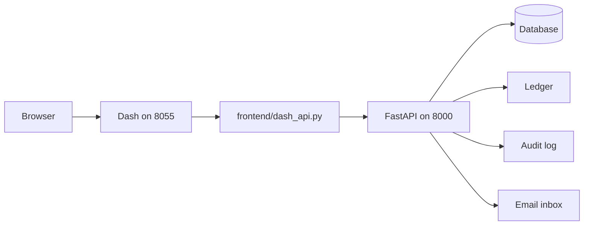

# How Dash calls the API

The browser never talks to FastAPI directly. It talks to Dash. Dash's server calls the API with `frontend/dash_api.py` and keeps the tokens in that process.



Start both from the repository root. One command reads `.env`, migrates, and serves the API on port 8000 and Dash on port 8055. Ctrl+C stops both.

```bash
./utils/dev-launch-local.sh
```

The script runs `uvicorn backend.api:app --reload --no-proxy-headers` and `python frontend/app_dash_web.py`. The Dash command line contains `app_dash_web.py`.

## Folder layout

`frontend/` is the Dash process. `backend/` is the FastAPI process. Shared tooling stays at the repo root.

```text
frontend/
  app_dash_web.py    Dash app. Port 8055. assets/ and pages/ are next to this file.
  dash_api.py        HTTP client. Tokens stay here, not in the browser.
  pages/             Layouts and callbacks. Dash pages_folder is "pages"; use_pages is off.
  assets/            CSS. Dash assets_folder is "assets", resolved beside app_dash_web.py.
backend/
  api.py             FastAPI app. uvicorn backend.api:app
  auth.py            Sign-in, sessions, bearer dependency, rate limits
  audit.py           Append-only audit log and admin read routes
  audit_email.py     HMAC of email addresses for audit and rate-limit keys
  circles.py         Circle routes
  clock.py           Time source
  database.py        Engine, session, models
  demo_accounts.py   admintest and membertest seed
  email_verification.py
  ledger.py          Double-entry tables
  ledger_admin.py    Platform-admin ledger read
  mail.py            Dev inbox
  password_reset.py
  roles.py           Per-circle role dependency
  stub_auth.py       Local stub policy and page gate
alembic.ini
migrations/          Schema. One Alembic head. env.py imports backend.database and backend.ledger.
ledger_balance.py    CI balance check. Not an API route. `python -m ledger_balance`
tests/
docs/
utils/dev-launch-local.sh
local/               Git-ignored runtime files. See below.
```

`index.html` and `src/*.jsx` are the old prototype. They are not part of either process.

## Local files and gitignore

These paths are relative to the process working directory. The launcher cds to the repo root before it starts either process, so moving the Python files into `backend/` and `frontend/` does not move the files on disk. `.gitignore` is unchanged:

| Path | What writes it | Gitignore |
|---|---|---|
| `local/ajo.db` | `DATABASE_URL=sqlite:///local/ajo.db` | `local/ajo.db` and `*.db` |
| `local/email-inbox/` | `backend/mail.py` when `AJO_ENV` is `local` or `dev` | `local/email-inbox/` |
| `local/audit-email-hmac.key` | `backend/audit_email.py` when the HMAC env var is unset on local or dev | `local/audit-email-hmac.key` |
| `local/stub-users.json` | You, copied from the example. The API only reads it. | `local/stub-users.json` |

A relative SQLite URL is resolved by the database driver from that same working directory, not from `backend/`.

## Auth flow

The access token is a bearer token. Dash sends it on the `Authorization` header. The browser does not.

1. The visitor submits a username and password to Dash.
2. `dash_api.sign_in` accepts only `admintest` or `membertest` when `AJO_ENV` is `local` or `dev`, maps the username to an `@example.test` address, and `POST`s `/api/v1/auth/login`.
3. The API checks the password, writes a short-lived JWT access token (15 minutes by default, from `clock.now()`), and a refresh token. The JWT carries the user id and the session id.
4. `TokenVault` in `frontend/dash_api.py` stores both tokens under an opaque id. The browser cookie stores that id. Tokens are not put in `localStorage`, the address bar, or the application log.
5. Later calls use `Authorization: Bearer <access-token>`. `get_current_user` verifies the JWT and checks that the session id inside it is still active, so logout works before the token expires.
6. A 401 retries once through `POST /api/v1/auth/refresh`. The refresh token rotates. A second use of an old refresh token fails and ends the session.
7. Circle and admin routes take that same `get_current_user` dependency. Role checks read the membership stored on the server. A role in the query, header, or body is ignored. Payout reads and role changes also go through `require_circle_permission`. Creating or joining a circle also requires a verified email.

Public routes (no bearer token) are signup, login, refresh, forgot password, reset password, and verification resend and confirm. `GET /health` only checks the database.

## Key endpoints

Product routes live under `/api/v1`. Names in `{braces}` are path parameters.

### Auth

See [docs/auth.md](auth.md).

- `POST /api/v1/auth/signup`
- `POST /api/v1/auth/login`
- `POST /api/v1/auth/refresh`
- `POST /api/v1/auth/logout`
- `GET /api/v1/auth/sessions`
- `DELETE /api/v1/auth/sessions/{session_id}`
- `POST /api/v1/auth/password/forgot`
- `POST /api/v1/auth/password/reset`
- `POST /api/v1/auth/verification/resend`
- `POST /api/v1/auth/verification/confirm`
- `GET /api/v1/me`

### Circles and roles

- `GET /api/v1/circles`
- `POST /api/v1/circles`
- `POST /api/v1/circles/{circle_id}/join`
- `GET /api/v1/circles/{circle_id}`
- `POST /api/v1/circles/{circle_id}/members/{user_id}/role`
- `GET /api/v1/circles/{circle_id}/payouts`

A member of the circle who is not an admin for it receives 403 on payouts. Someone who is not in the circle receives 404. A role change is written to the audit log. See [docs/audit-log.md](audit-log.md).

### Admin

- `GET /api/v1/admin/audit` and the HTML page `GET /admin/audit`
- `GET /api/v1/admin/ledger` and the HTML page `GET /admin/ledger`

Both require a platform admin. See [docs/ledger.md](ledger.md).

### Other

`GET /health` checks the database. It is not under `/api/v1`.

`GET /api/v1/dev/clock` and `POST /api/v1/dev/clock` exist only when the dev clock control is allowed (loopback, `ALLOW_TEST_CLOCK`, and `AJO_ENV` of `local` or `dev`). The caller must be `127.0.0.1` or `::1`.

## Environment variables

Set these in `.env` at the repo root. No real secrets belong in the repo. `.env.example` shows the names and placeholders.

| Variable | Who reads it | Notes |
|---|---|---|
| `JWT_SECRET_KEY` | API | Required. At least 32 characters. The example placeholder is refused. |
| `DATABASE_URL` | API and Alembic | Required. Local: `sqlite:///local/ajo.db`. |
| `AJO_ENV` | API and Dash | `local` or `dev` enables `/docs`, the dev inbox, and the dev clock rules. |
| `AJO_API_BASE` | Dash | API origin, for example `http://127.0.0.1:8000`. The Dash main block fills this in when it is empty. Tests leave it empty. |
| `ACCESS_TOKEN_MINUTES` | API | 1 to 60. Default 15. |
| `REFRESH_TOKEN_DAYS` | API | 1 to 30. Default 14. |
| `DASH_HOST` | Dash | Default `127.0.0.1`. |
| `DASH_PORT` | Dash | Default `8055`. |
| `DASH_DEBUG` | Dash | Default off. |
| `PUBLIC_APP_URL` | API email links | Dash origin. Default `http://localhost:8055`. Not taken from the request Host header. |
| `EMAIL_SENDER` | API | `dev` is allowed only when `AJO_ENV` is `local` or `dev`. |
| `AUDIT_EMAIL_HMAC_KEY` | API | Required outside local and dev. On a laptop, leave it empty and the key file is created. |
| `ALLOW_LOCAL_STUB_LOGIN` | API and Dash | Keep false when Dash calls the API. |
| `SEED_DEMO_ACCOUNTS` | API and Dash | `true` only for local or dev. Seeds `admintest` and `membertest` from `local/stub-users.json`. |
| `ALLOW_TEST_CLOCK` | API and Dash | Keep false except tests and a loopback local/dev process. |
| `STUB_USERS_FILE` | API | Default `local/stub-users.json`. |

## Docs gating

`/docs`, `/redoc`, and `/openapi.json` are registered only when `AJO_ENV`, trimmed and compared case-insensitively, is `local` or `dev`. Unset, `prod`, `staging`, and any other value make all three respond with 404. The check is `openapi_docs_enabled()` in `backend/api.py`.

## Timeouts and error codes

Every Dash call to the API uses one 4 second timeout (`API_TIMEOUT_SECONDS` in `frontend/dash_api.py`).

A connection error, a timeout, or a 5xx response shows **Service unavailable, please try again shortly**. The visitor stays signed in.

| Status | Meaning |
|---|---|
| 401 | Not signed in, or the access token has expired. Dash tries one refresh, then treats the call as signed out if that refresh fails. |
| 403 | The stored role is not allowed to do this. |
| 404 | Not in that circle, or the record was not found. |
| 429 | Rate limited. See [docs/auth.md](auth.md). |
| 5xx | Outage. The page shows the message above and the user stays signed in. |

## Example calls

Synthetic data only. `<access-token>` is a placeholder. Do not paste a real token into this file.

From the Dash process, with the API already running:

```python
import os

os.environ["AJO_ENV"] = "local"
os.environ["AJO_API_BASE"] = "http://127.0.0.1:8000"

import frontend.dash_api as dash_api

status, body = dash_api.signup(
    "Ada Example",
    "ada.example@example.test",
    "example-password",
)

identity = dash_api.sign_in("admintest", "example-password")
status, me = dash_api.request("GET", "/api/v1/me", sid=identity.sid)
circles = dash_api.load_circles(identity.sid)
```

`sign_in` only accepts `admintest` and `membertest`, and only when `AJO_ENV` is `local` or `dev`. `signup` only sends an `@example.test` address. The password above is not a credential from this repo.

The same two calls with curl. The login response's `access_token` is what you put in the second header. This page shows the placeholder, not a token:

```bash
curl -sS -X POST http://127.0.0.1:8000/api/v1/auth/login \
  -H 'Content-Type: application/json' \
  -d '{"email":"admintest@example.test","password":"example-password"}'

curl -sS http://127.0.0.1:8000/api/v1/me \
  -H 'Authorization: Bearer <access-token>'

curl -sS http://127.0.0.1:8000/api/v1/circles \
  -H 'Authorization: Bearer <access-token>'
```

Forgot-password from Dash, and the same call with curl. The response does not say whether the address exists:

```python
status, body = dash_api.forgot_password("ada.example@example.test")
```

```bash
curl -sS -X POST http://127.0.0.1:8000/api/v1/auth/password/forgot \
  -H 'Content-Type: application/json' \
  -d '{"email":"ada.example@example.test"}'
```

On `AJO_ENV=local` with the dev sender, the reset link is a file under `local/email-inbox`. It points at `PUBLIC_APP_URL` (Dash), not at port 8000.

## Try the outage message

1. Start `./utils/dev-launch-local.sh` and sign in as `membertest`.
2. Stop only the API. Ctrl+C on the launcher stops Dash as well, so leave that terminal running and stop uvicorn from another shell: `pkill -f 'uvicorn backend.api:app'`.
3. Open `/members` and `/dashboard`.
4. Start `./utils/dev-launch-local.sh` again.

Both pages show **Service unavailable, please try again shortly**, and you stay signed in. After the API is running again, reload either page.
